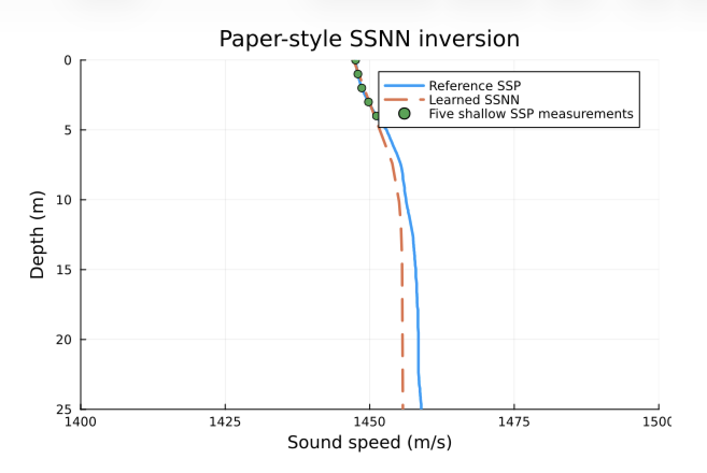
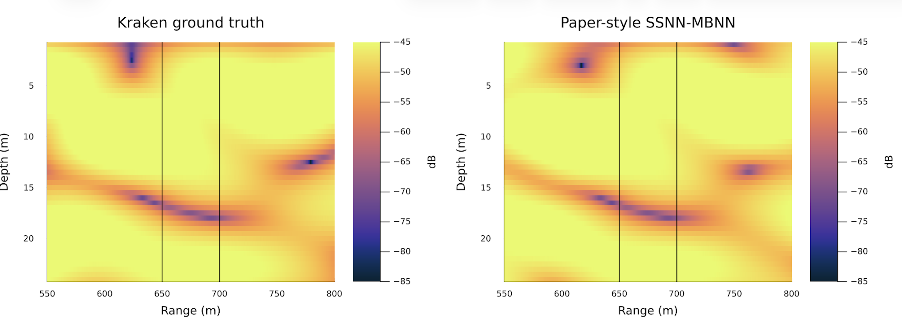

# Joint field prediction and sound-speed inversion

This example reproduces the modal experiment from "Physics-aided data-driven
modal ocean acoustic propagation modeling" (ICA 2022): recovering both the
acoustic field and the unknown sound-speed profile (SSP) of a shallow waveguide
from sparse amplitude measurements. Paste each block into the Julia REPL in
order.

The setup is a 25 m deep waveguide at 500 Hz with a sandy-clay seabed. Kraken
generates synthetic ground truth from a reference SSP: 1,224 amplitude
measurements in a narrow 650–700 m range band (split 70/30 into training and
validation), and a wider 550–800 m area of interest used only for evaluation.

## 1. Load packages

```julia
using UnderwaterAcoustics
using DataDrivenAcoustics
using AcousticsToolbox
using StableRNGs
using Random, Statistics
using Plots
```

## 2. Settings

The loss is the paper's eqn. 22 (field error plus L1 penalties on the modal
coefficients), with two SSP terms added: an anchor term for five shallow SSP
measurements (Section III-B / Fig. 10), and a soft prior that keeps the total
SSP variation below 35 m/s.

```julia
const D = 25.0;             const FREQ = 500.0;       const SOURCE_DEPTH = 5.0
const NMODES = 6;           const NHIDDEN = 12;       const RREF = 675.0
const CMIN = 1400.0;        const CMAX = 1500.0;      const CINIT = 1450.0
const RESTARTS = 10;        const MAXITERS = 8000;    const LEARNING_RATE = 1f-3
const ALPHA = 1f-6;         const BETA = 1f-6         # eqn. 22 L1 weights
const LAMBDA_SSP = 20f0;    const LAMBDA_SPAN = 1f0;  const MAX_SSP_SPAN = 35f0
const SSP_ANCHOR_DEPTHS = [0.0, 1.0, 2.0, 3.0, 4.0]
```

`CMIN` and `CMAX` bracket the water's sound speed, which is 1447–1459 m/s in
this environment. They are deliberately tighter than the package defaults,
since a narrower interval makes the inversion better conditioned.
`DataDrivenPropagationModel` and `ModalBasisNN_2D` both use the default
`soundspeed()` (about 1539 m/s) as a reference speed, but only to encode the
source frequency as a wavenumber. It is not a property of this water column,
so it does not need to lie between `CMIN` and `CMAX`.

## 3. Reference sound-speed profile

The reference SSP, digitized from the paper's published profile at 0.125 m
intervals. The model never sees it, apart from the five anchor values at
0–4 m:

```julia
c_ref = [
  1447.555, 1447.589, 1447.629, 1447.673, 1447.722, 1447.774, 1447.83, 1447.889,
  1447.95, 1448.015, 1448.086, 1448.163, 1448.244, 1448.332, 1448.425, 1448.524,
  1448.628, 1448.742, 1448.87, 1449.008, 1449.156, 1449.31, 1449.467, 1449.627,
  1449.785, 1449.944, 1450.106, 1450.272, 1450.442, 1450.616, 1450.795, 1450.979,
  1451.169, 1451.366, 1451.569, 1451.779, 1451.996, 1452.218, 1452.447, 1452.68,
  1452.92, 1453.033, 1453.145, 1453.315, 1453.428, 1453.541, 1453.682, 1453.823,
  1453.936, 1454.049, 1454.19, 1454.331, 1454.444, 1454.614, 1454.727, 1454.84,
  1454.953, 1455.066, 1455.178, 1455.291, 1455.376, 1455.461, 1455.517, 1455.574,
  1455.63, 1455.687, 1455.715, 1455.743, 1455.743, 1455.8, 1455.856, 1455.913,
  1455.969, 1456.026, 1456.026, 1456.026, 1456.082, 1456.138, 1456.195, 1456.251,
  1456.28, 1456.308, 1456.364, 1456.421, 1456.477, 1456.534, 1456.647, 1456.647,
  1456.731, 1456.816, 1456.873, 1456.929, 1456.986, 1457.042, 1457.098, 1457.155,
  1457.211, 1457.268, 1457.324, 1457.381, 1457.437, 1457.494, 1457.522, 1457.522,
  1457.55, 1457.55, 1457.607, 1457.607, 1457.663, 1457.663, 1457.72, 1457.72,
  1457.776, 1457.776, 1457.776, 1457.833, 1457.861, 1457.861, 1457.889, 1457.946,
  1457.974, 1457.974, 1457.974, 1457.974, 1457.974, 1458.002, 1458.059, 1458.087,
  1458.115, 1458.115, 1458.115, 1458.115, 1458.115, 1458.115, 1458.171, 1458.171,
  1458.2, 1458.2, 1458.2, 1458.2, 1458.228, 1458.228, 1458.284, 1458.341,
  1458.341, 1458.341, 1458.341, 1458.341, 1458.341, 1458.341, 1458.341, 1458.341,
  1458.341, 1458.341, 1458.369, 1458.397, 1458.426, 1458.426, 1458.426, 1458.426,
  1458.426, 1458.426, 1458.426, 1458.426, 1458.426, 1458.426, 1458.426, 1458.426,
  1458.426, 1458.426, 1458.426, 1458.426, 1458.426, 1458.426, 1458.426, 1458.426,
  1458.426, 1458.426, 1458.426, 1458.426, 1458.454, 1458.482, 1458.51, 1458.51,
  1458.539, 1458.539, 1458.567, 1458.623, 1458.68, 1458.68, 1458.68, 1458.736,
  1458.736, 1458.793, 1458.793, 1458.821, 1458.849, 1458.906, 1458.906, 1458.906,
  1458.906
]
z_grid = range(0.0, -D; length=length(c_ref))   # depths in m, negative below the surface
ref_ssp = SampledField(c_ref; z=z_grid, interp=CubicSpline())
```

## 4. Generate ground truth with Kraken

```julia
env = UnderwaterEnvironment(bathymetry=D, soundspeed=ref_ssp, seabed=SandyClay)
kraken = Kraken(env; rmax=850.0, nmodes=NMODES)
tx = AcousticSource(0.0, -SOURCE_DEPTH, FREQ; spl=0.0)

# 51 ranges × 24 depths = 1,224 measurements in the 650–700 m band
ranges, depths = 650.0:1.0:700.0, 1.0:1.0:24.0
amp = vec(abs.(acoustic_field(kraken, tx, AcousticReceiverGrid2D(ranges, -depths))))
rxs = vec([AcousticReceiver(r, -d) for r ∈ ranges, d ∈ depths])

# seeded 70/30 train/validation split
idx = randperm(StableRNG(1), length(rxs))
ntrain = round(Int, 0.7 * length(rxs))
itrain, ival = idx[1:ntrain], idx[ntrain+1:end]

# normalize amplitudes by the mean training amplitude
yscale = Float32(mean(amp[itrain]))
y = Float32.(amp ./ yscale)
```

## 5. Define the model and the loss

The loss is built for a given propagation model `pm` and receiver subset, and
has the `(ps, _) -> …` form that `fit!` expects:

```julia
model = ModalBasisNN_2D(D, FREQ; nmodes=NMODES, nhidden=NHIDDEN,
                        cmin=CMIN, cmax=CMAX, cinit=CINIT, rref=RREF)

c_anchor = Float32.(ref_ssp.(-SSP_ANCHOR_DEPTHS))
l1(re, im) = sum(sqrt.(re .^ 2 .+ im .^ 2 .+ 1f-12))   # smoothed so the gradient exists at 0
hinge(x) = (x + abs(x)) / 2                           # max(x, 0) without a branch

field_mse(pm, ps, ii) = mean(abs2, abs.(acoustic_field(pm(ps), tx, rxs[ii])) ./ yscale .- y[ii])

function eqn22_loss(pm, ii)
  (ps, _) -> begin
    ssp = sound_speed_grid(pm.model, ps)
    c = ssp.(z_grid)
    # total variation equals the span for a monotone profile
    tv = sum(abs.(c[2:end] .- c[1:end-1]))
    field_mse(pm, ps, ii) +
      ALPHA * l1(ps.A_re, ps.A_im) + BETA * l1(ps.B_re, ps.B_im) +
      LAMBDA_SSP * mean(abs2, (ssp.(-SSP_ANCHOR_DEPTHS) .- c_anchor) ./ MAX_SSP_SPAN) +
      LAMBDA_SPAN * (hinge(tv - MAX_SSP_SPAN) / MAX_SSP_SPAN)^2
  end
end
```

`hinge` and the total variation keep the loss free of value-dependent branches
like `max` and `maximum`, which a compiled ReverseDiff tape (the `fit!`
default) would fix at their first evaluation.

## 6. Train with random restarts

Each restart trains from a different seeded initialization; the restart with
the lowest validation field error is kept:

```julia
best, best_val = nothing, Inf
for restart ∈ 1:RESTARTS
  pm = DataDrivenPropagationModel(model; rng=StableRNG(restart))
  DataDrivenAcoustics.fit!(pm, eqn22_loss(pm, itrain);
                           optimizer=Adam(LEARNING_RATE), maxiters=MAXITERS)
  val = field_mse(pm, pm.params, ival)
  println("Restart $restart: validation field MSE = $val")
  if val < best_val
    global best, best_val = pm, val
  end
end
```

## 7. Evaluate the learned sound-speed profile

```julia
c_pred = sound_speed_grid(best.model, best.params).(z_grid)
println("SSP RMSE = ", sqrt(mean(abs2, c_pred .- c_ref)), " m/s")

plot(c_ref, -z_grid; yflip=true, lw=2.5, label="Reference SSP",
     xlabel="Sound speed (m/s)", ylabel="Depth (m)", title="SSP inversion",
     xlims=(1400, 1500), ylims=(0, 25))
plot!(c_pred, -z_grid; lw=2.5, ls=:dash, label="Learned SSP")
scatter!(c_anchor, SSP_ANCHOR_DEPTHS; ms=4, label="Five shallow SSP measurements")
```



## 8. Evaluate the field over the area of interest

The model is compared against Kraken over 550–800 m, well outside the
650–700 m training band (black lines):

```julia
aoi = AcousticReceiverGrid2D(550.0:0.5:800.0, -(1.0:0.5:24.0))
db_true = 20 .* log10.(abs.(acoustic_field(kraken, tx, aoi)))
db_pred = 20 .* log10.(abs.(acoustic_field(best, tx, aoi)))
println("AOI dB RMSE = ", sqrt(mean(abs2, db_pred .- db_true)))

hm(db, title) = heatmap(550.0:0.5:800.0, 1.0:0.5:24.0, permutedims(db); yflip=true,
                        clims=(-85, -45), c=:thermal, title, xlabel="Range (m)",
                        ylabel="Depth (m)", colorbar_title="dB")
p1 = vline!(hm(db_true, "Kraken ground truth"), [650.0, 700.0]; c=:black, label="")
p2 = vline!(hm(db_pred, "MBNN prediction"), [650.0, 700.0]; c=:black, label="")
plot(p1, p2; layout=(1, 2), size=(1300, 430), margin=5Plots.mm)
```



## Publications

- K. Li and M. Chitre, "Physics-aided data-driven modal ocean acoustic
  propagation modeling," in International Congress of Acoustics, 2022.
  [(online)](https://arl.nus.edu.sg/wp-content/uploads/2022/09/Kexin_Physics-aided_ICAKorea2022.pdf)
