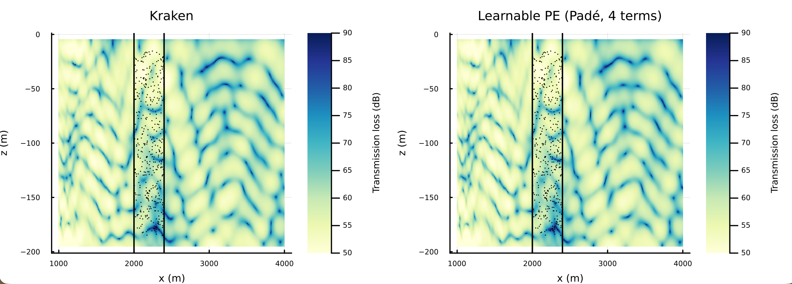
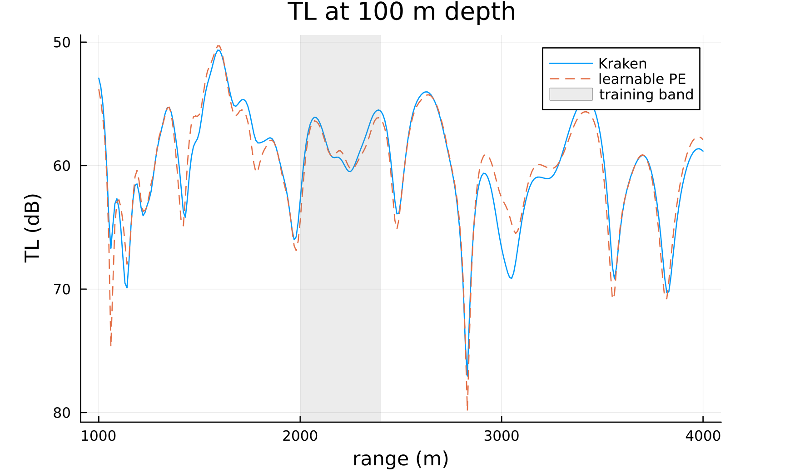
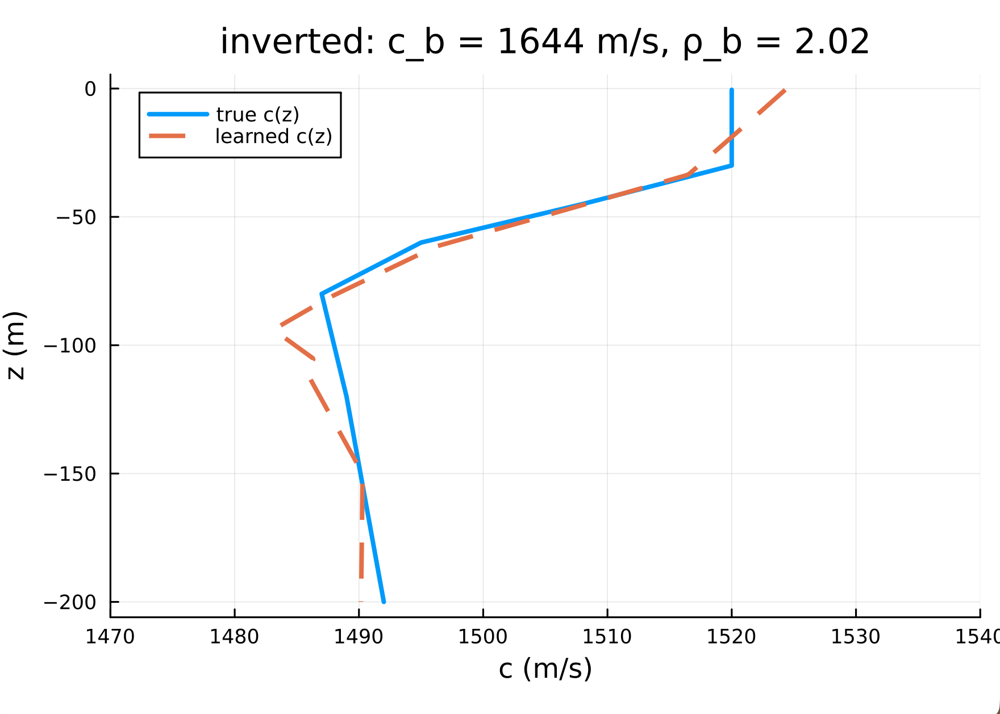

# Sample Implementation

This walks through the entire example chunk by chunk. Paste each block into
the Julia REPL **in order** and it produces a comparison against ground truth
generated by Kraken.

# Field prediction and geoacoustic inversion with a learnable parabolic equation

This example trains `ParabolicEquationNN_2D`, a learnable parabolic equation,
on sparse complex-field measurements from a shallow waveguide, and uses it both
to predict the field far outside the measurement region and to invert for the
environment.

The model writes the field as p(r, z) = s ψ(r, z) H₀⁽¹⁾(k₀r) and marches the
envelope ψ out in range with Collins' split-step Padé method:

    ∂ψ/∂r = ik₀(√(1 + X) − 1) ψ,   √(1 + X) − 1 ≈ Σⱼ aⱼ X / (1 + bⱼ X)

Here X is the depth operator [ρ ∂z(ρ⁻¹∂z) + k²(z) − k₀²] / k₀², discretised by
finite differences. What is learned is the environment that enters X: the
water sound speed c(z), and the seabed sound speed, density ratio and
attenuation, plus a complex source factor s. This is the same set of unknowns
as `WavenumberIntegrationNN_2D`, so the two models can be compared directly;
unlike wavenumber integration, the PE marches step by step in range, so the
environment is free to change along the way.

The setup is the same as the wavenumber-integration example: a 200 m deep
waveguide at 100 Hz over a fluid seabed (sound speed 1650 m/s, density ratio
1.8), with a source at 40 m. Kraken generates 400 complex-field measurements at
random positions in a narrow 2.0–2.4 km range band, plus a dense evaluation
grid covering 1–4 km. The model only ever sees the narrow band.

Training uses L-BFGS, after a coarse scan over the seabed sound speed to start
in the right basin. Gradients come from a hand-written adjoint of the march,
which `Zygote` picks up automatically; a gradient costs about three marches,
however many parameters there are.

## 1. Load packages

`ParabolicEquationNN_2D`, `seabed_parameters` and `sound_speed_grid` come in
with `DataDrivenAcoustics`. `AcousticsToolbox` provides Kraken for the ground
truth. `Zygote` provides the gradients, through the adjoint registered for the
march, and `Optim` provides L-BFGS:

```julia
using UnderwaterAcoustics
using DataDrivenAcoustics
using AcousticsToolbox
using StableRNGs
using Plots

using LinearAlgebra, Statistics
using Lux, ComponentArrays, Zygote, Optim

gr() #plots backend
```

## 2. Settings

Environment, measurement layout, model bounds and training budget. The true
seabed values are only used to generate the ground truth and to report the
inversion error; the model is never given them:

```julia
const D = 200.0;        const FREQ = 100.0;     const SOURCE_Z = -40.0
const C_WATER = 1500.0
const SEABED_C = 1650.0; const SEABED_RHO = 1.8   #ground truth only
const NPOINTS = 400
const BAND = (2000.0, 2400.0)                     #measurement ranges (m)
const DEPTHS = (15.0, 185.0)                      #measurement depths (m)
const AOI_X = 1000.0:10.0:4000.0;  const AOI_Z = -195.0:1.0:-5.0

#water sound speed bounds plus the initial guess
const CMIN = 1400.0;  const CMAX = 1600.0;  const CINIT = 1500.0
#seabed sound speeds tried before training to pick a starting basin
const CB_SCAN = 1525.0:50.0:2475.0
const ITERATIONS = 50

#plots
const FIELD_PLOT_FILE = "pe_field.png"
const TL_PLOT_FILE    = "pe_tl_100m.png"
const SSP_PLOT_FILE   = "pe_ssp.png"

save_plot(plt, f) = (display(plt); savefig(plt, joinpath(@__DIR__, f)); println("Saved: ", joinpath(@__DIR__, f)))
```

## 3. Generate the ground truth

One Kraken run gives the 400 complex-field measurements in the band:

```julia
env = UnderwaterEnvironment(bathymetry = D, soundspeed = C_WATER,
                            seabed = FluidBoundary(SEABED_RHO * 1000.0, SEABED_C))
pm = Kraken(env)
tx = AcousticSource(0.0, SOURCE_Z, FREQ)

rxpos = rand(StableRNG(1224), 2, NPOINTS) .*
        [BAND[2] - BAND[1], DEPTHS[2] - DEPTHS[1]] .+ [BAND[1], -DEPTHS[2]]
rxs = [AcousticReceiver(rxpos[1, i], rxpos[2, i]) for i ∈ 1:NPOINTS]
xfield = ComplexF64.(acoustic_field(pm, tx, rxs))
```

## 4. Build the model and the training inputs

The model takes the water depth, frequency and source depth; the source depth
is assumed known. The defaults (0.5 m depth step, 2 m range step, 4 Padé
terms, and a computational domain three water depths deep with an absorbing
sponge in its lowest third) are the settings validated for this waveguide.
Targets are normalised by their largest magnitude so the loss is O(1):

```julia
model = ParabolicEquationNN_2D(D, FREQ, SOURCE_Z; cmin = CMIN, cmax = CMAX, cinit = CINIT)
println("depth nodes: ", length(model.zn))

make_input(r, z) = vcat(r', z', fill(2π * FREQ / soundspeed(), 1, length(r)))
X_train = make_input(rxpos[1, :], rxpos[2, :])

scalefac = maximum(abs, xfield)
yv = xfield ./ scalefac

ps0, st = Lux.setup(StableRNG(42), model)
ps0 = ComponentArray(ps0)
```

## 5. Define the loss

Relative complex-field misfit. The overall source level and phase are a single
complex number that enters the field linearly, so rather than training it, it
is solved exactly by least squares on every evaluation; this keeps the
optimiser focused on the environment:

```julia
function misfit(θ, y)
    out, _ = model(X_train, θ, st)
    p = complex.(out[1, :], out[2, :])
    α = dot(p, y) / dot(p, p)          #best complex source factor
    sum(abs2, α .* p .- y) / sum(abs2, y)
end
```

The model assumes e^{-iωt} time dependence, for which H₀⁽¹⁾ is the outgoing
wave. If the data were generated with the opposite convention, the field is
the complex conjugate, and the conjugated data will fit much better:

```julia
flip = misfit(ps0, conj.(yv)) < misfit(ps0, yv)
y_train = flip ? conj.(yv) : yv
println("time convention: ", flip ? "conjugated" : "as is")
```

## 6. Warm-start the seabed

The misfit has local minima in the seabed sound speed, which moves the
critical angle and with it which energy stays trapped in the waveguide. A
coarse scan, keeping all other parameters at their initial values, picks the
starting basin:

```julia
seabed_logit(cb) = log((cb - model.cb_lo) / (model.cb_hi - cb))
function with_seabed_c(θ, cb)
    θ2 = copy(θ)
    θ2.seabed.qc = seabed_logit(cb)
    θ2
end

scan = [misfit(with_seabed_c(ps0, cb), y_train) for cb ∈ CB_SCAN]
θ0 = with_seabed_c(ps0, CB_SCAN[argmin(scan)])
println("seabed c scan picked ", CB_SCAN[argmin(scan)], " m/s, misfit ",
        round(minimum(scan); sigdigits = 3))
```

## 7. Check the gradient

`Zygote` differentiates the loss, using the adjoint registered for the march.
Before training, it is worth comparing that gradient against a finite
difference along a random direction; the two numbers should agree to five or
six significant figures:

```julia
loss(θ) = misfit(θ, y_train)
gradient_of(θ) = ComponentArray(Zygote.gradient(loss, θ)[1])

let d = randn(StableRNG(7), length(θ0)), h = 1e-4
    fd = (loss(θ0 .+ h .* d) - loss(θ0 .- h .* d)) / 2h
    println("finite difference ", round(fd; sigdigits = 6),
            ", adjoint ", round(dot(gradient_of(θ0), d); sigdigits = 6))
end
```

## 8. Train

L-BFGS with the adjoint gradient. A line search only needs the loss, which is
a single march; a gradient is a march forward and one backward:

```julia
grad!(G, θ) = copyto!(G, gradient_of(θ))
result = optimize(loss, grad!, θ0,
                  LBFGS(linesearch = Optim.LineSearches.BackTracking()),
                  Optim.Options(iterations = ITERATIONS, show_trace = true, show_every = 5))
ps = ComponentArray(collect(Optim.minimizer(result)), getaxes(θ0))
println("final relative misfit: ", round(loss(ps); sigdigits = 3))
```

The least-squares source factor is then folded into the model's own `s`, so
the trained model can be called directly without the loss:

```julia
out, _ = model(X_train, ps, st)
p = complex.(out[1, :], out[2, :])
s = (dot(p, y_train) / dot(p, p)) * complex(ps.s_re, ps.s_im)
ps.s_re, ps.s_im = real(s), imag(s)
```

## 9. Inspect the inverted environment

The seabed and the water sound speed, against the values the model was never
given:

```julia
sb = seabed_parameters(model, ps)
println("seabed c = ", round(sb.c; digits = 1), " m/s (true ", SEABED_C, ")")
println("seabed ρ = ", round(sb.ρ; digits = 2), " (true ", SEABED_RHO, ")")
println("seabed α = ", round(sb.α; digits = 3), " dB/λ (true 0)")

z_water = model.zn[1:model.iD]
c_pred = DataDrivenAcoustics._pe_sound_speed(model, ps)
println("water c RMSE = ", round(sqrt(mean((c_pred .- C_WATER) .^ 2)); digits = 2), " m/s")

p_ssp = plot(c_pred, -z_water; lw = 2.5, label = "learned c(z)",
             xlabel = "c (m/s)", ylabel = "z (m)", xlims = (CMIN, CMAX),
             title = "inverted: c_b = $(round(Int, sb.c)) m/s, ρ_b = $(round(sb.ρ; digits = 2))")
vline!(p_ssp, [C_WATER]; ls = :dash, label = "true ($(Int(C_WATER)) m/s)")
save_plot(p_ssp, SSP_PLOT_FILE)
```

> [!NOTE]
> As with the other models, `sound_speed_grid(model, ps)` returns a
> `SampledField` wrapper. The internal `_pe_sound_speed` returns the same
> profile as a plain vector on the water nodes `model.zn[1:model.iD]`, which is
> what plotting needs.

## 10. Evaluate the field over the area of interest

Predict over the full 1–4 km grid and compare against Kraken. A single march
out to 4 km serves every receiver, so the whole grid is one model call:

```julia
rx = AcousticReceiverGrid2D(AOI_X, AOI_Z)
tl_true = transmission_loss(pm, tx, rx)

R = vec(repeat(collect(AOI_X), 1, length(AOI_Z)))
Z = vec(repeat(collect(AOI_Z)', length(AOI_X), 1))
out, _ = model(make_input(R, Z), ps, st)
pf = scalefac .* complex.(out[1, :], out[2, :])
flip && (pf = conj.(pf))
tl_pred = reshape(-20 .* log10.(abs.(pf) .+ 1e-12), size(tl_true))

outside = reshape((R .< BAND[1]) .| (R .> BAND[2]), size(tl_true))
println("TL RMSE outside the training band = ",
        round(sqrt(mean((tl_pred .- tl_true)[outside] .^ 2)); digits = 2), " dB")

p1 = plot(rx, tl_true; clim = (50, 90), title = "Kraken")
scatter!(p1, rxpos[1, :], rxpos[2, :]; markersize = 0.5, color = :black, label = "")
p2 = plot(rx, tl_pred; clim = (50, 90), title = "Learnable PE (Padé, 4 terms)")
scatter!(p2, rxpos[1, :], rxpos[2, :]; markersize = 0.5, color = :black, label = "")
save_plot(plot(p1, p2; layout = (1, 2), size = (1300, 450), margin = 5 * Plots.mm),
          FIELD_PLOT_FILE)
```

A single depth shows the detail more clearly:

```julia
iz = findfirst(==(-100.0), AOI_Z)
p_tl = plot(AOI_X, tl_true[:, iz]; label = "Kraken", xlabel = "range (m)",
            ylabel = "TL (dB)", title = "TL at 100 m depth", yflip = true)
plot!(p_tl, AOI_X, tl_pred[:, iz]; label = "learnable PE", ls = :dash)
vspan!(p_tl, collect(BAND); alpha = 0.15, color = :gray, label = "training band")
save_plot(p_tl, TL_PLOT_FILE)
```

Done — the three PNGs land next to the script.

## Final Plots

After the programme is run, it displays three figures. The first compares
Kraken ground truth with the learnable PE over the full area of interest; the
measurement positions are marked in black:



The second compares transmission loss at 100 m depth, with the training band
shaded. The prediction follows Kraken from 1 km to 4 km, including the deep
nulls, far outside the band the model was trained on:



The third shows the inverted water sound speed against the true profile, with
the recovered seabed sound speed and density ratio in the title:



## Notes on the method

- **Why split-step Padé rather than split-step Fourier.** Split-step Fourier
  is the textbook PE solver and is essentially exact in a uniform medium, but
  a Fourier method cannot represent the density jump and sound-speed step at
  the seabed; for this waveguide it was 2–6 dB off. The finite-difference
  Padé march takes the density at half nodes, so the interface is exact, and
  agrees with a converged wavenumber integral to about 0.4 dB rms from 1 to
  4 km. Halving the depth step to 0.25 m halves that error at twice the cost.
- **Why the gradient is cheap.** Differentiating the march with forward-mode
  AD costs one march per parameter (or per chunk of parameters). Instead, the
  layer registers a hand-written adjoint: the field is marched forward once,
  keeping every intermediate state, and a sensitivity field is marched
  backwards once through the conjugate-transposed Padé steps. This yields the
  sensitivity to every entry of the depth operator, from which the gradient
  with respect to the environment follows without another march.
- **Range dependence.** The march applies the depth operator one range step at
  a time, so a range-dependent environment only requires the operator to be
  rebuilt along the way. This is the main advantage of the PE over wavenumber
  integration, which assumes the environment is the same at every range.

## Publications

- M. D. Collins, "A split-step Padé solution for the parabolic equation
  method," *J. Acoust. Soc. Am.*, vol. 93, no. 4, pp. 1736–1742, 1993.
- F. B. Jensen, W. A. Kuperman, M. B. Porter, and H. Schmidt, *Computational
  Ocean Acoustics*, 2nd ed. New York: Springer, 2011. (Chapter 6: parabolic
  equations.)
- K. Li and M. Chitre, "Physics-aided data-driven modal ocean acoustic
  propagation modeling," in International Congress of Acoustics, 2022.
  [(online)](https://arl.nus.edu.sg/wp-content/uploads/2022/09/Kexin_Physics-aided_ICAKorea2022.pdf)
