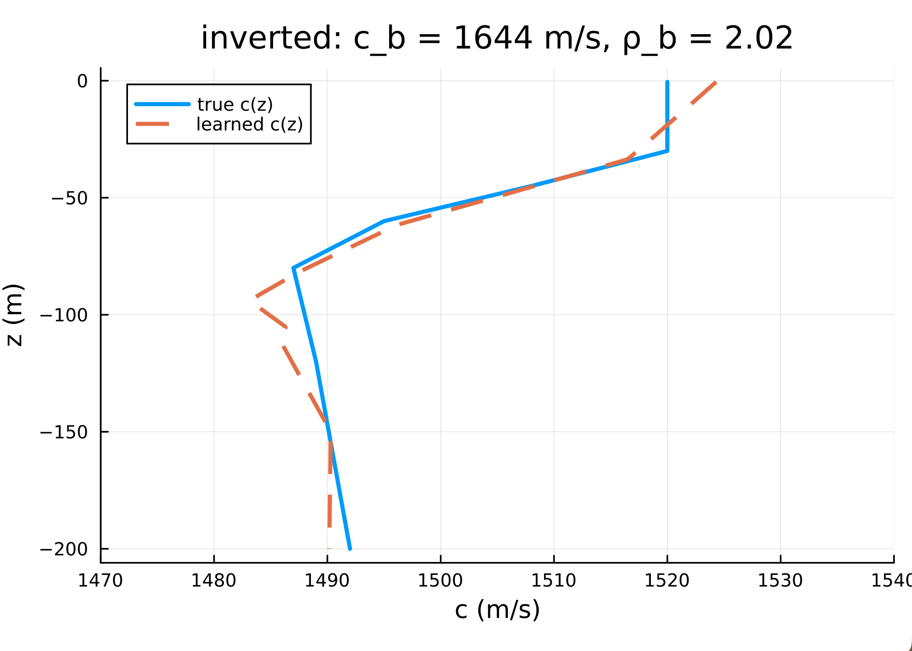
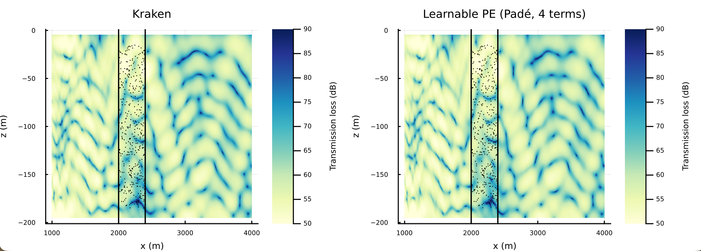
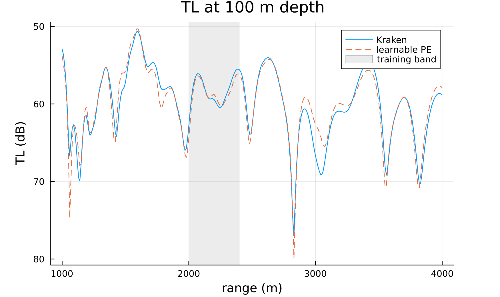

# Field prediction and geoacoustic inversion with a learnable parabolic equation

This example trains `ParabolicEquationNN_2D`, a learnable parabolic equation,
on sparse complex-field measurements from a shallow waveguide, and uses it both
to predict the field far outside the measurement region and to invert for the
environment. Paste each block into the Julia REPL in order.

The model writes the field as p(r, z) = s ψ(r, z) H₀⁽¹⁾(k₀r) and marches the
envelope ψ out in range with a Padé-series approximation of the one-way
equation, each term advanced by a Crank–Nicolson step:

    ∂ψ/∂r = ik₀(√(1 + X) − 1) ψ,   √(1 + X) − 1 ≈ Σⱼ aⱼ X / (1 + bⱼ X)

Here X is the depth operator [ρ ∂z(ρ⁻¹∂z) + k²(z) − k₀²] / k₀², discretised by
finite differences. What is learned is the environment that enters X: the
water sound speed c(z), and the seabed sound speed, density ratio and
attenuation, plus a complex source factor s. This is the same set of unknowns
as `WavenumberIntegrationNN_2D`, so the two models can be compared directly;
unlike wavenumber integration, the PE marches step by step in range, so the
environment is free to change along the way.

The setup is a 200 m deep waveguide at 100 Hz with a summer sound-speed
profile (a warm mixed layer, a sharp thermocline between 30 and 80 m, and a
slow increase towards the seabed), over a fluid seabed (sound speed 1650 m/s,
density ratio 1.8), with a source at 40 m. Kraken generates 400 complex-field
measurements at random positions in a narrow 2.0–2.4 km range band, plus a
dense evaluation grid covering 1–4 km. The model only ever sees the narrow
band, and is never given the sound-speed profile or the seabed.

## 1. Load packages

`AcousticsToolbox` provides Kraken for the ground truth:

```julia
using UnderwaterAcoustics
using DataDrivenAcoustics
using AcousticsToolbox
using StableRNGs
using Statistics
using Plots
```

## 2. Settings

The true sound-speed profile and seabed are only used to generate the ground
truth and to report the inversion error; the model is never given them:

```julia
const D = 200.0;          const FREQ = 100.0;       const SOURCE_Z = -40.0
const SEABED_C = 1650.0;  const SEABED_RHO = 1.8    # ground truth only
const BAND = (2000.0, 2400.0)                        # measurement ranges (m)
const DEPTHS = (15.0, 185.0)                         # measurement depths (m)
const AOI_X = 1000.0:10.0:4000.0;  const AOI_Z = -195.0:1.0:-5.0
const CB_SCAN = 1525.0:50.0:2475.0                   # seabed sound speeds tried before training
const ITERATIONS = 50
```

## 3. Generate the ground truth

The true profile has a warm mixed layer, a sharp thermocline between 30 and
80 m, and a slow increase towards the seabed. One Kraken run gives the 400
complex-field measurements in the band:

```julia
true_ssp = SampledField([1520.0, 1520.0, 1508.0, 1495.0, 1487.0, 1489.0, 1492.0];
                        z=-[0.0, 30.0, 45.0, 60.0, 80.0, 120.0, 200.0], interp=Linear())
env = UnderwaterEnvironment(bathymetry=D, soundspeed=true_ssp,
                            seabed=FluidBoundary(SEABED_RHO * 1000.0, SEABED_C))
kraken = Kraken(env)
tx = AcousticSource(0.0, SOURCE_Z, FREQ)

rxpos = rand(StableRNG(1224), 2, 400) .*
        [BAND[2] - BAND[1], DEPTHS[2] - DEPTHS[1]] .+ [BAND[1], -DEPTHS[2]]
rxs = [AcousticReceiver(rxpos[1, i], rxpos[2, i]) for i ∈ 1:size(rxpos, 2)]
xfield = ComplexF64.(acoustic_field(kraken, tx, rxs))
```

## 4. Build the model and the loss

The model takes the water depth, frequency and source depth; the source depth
is assumed known. The defaults (0.5 m depth step, 2 m range step, 4 Padé
terms, and a computational domain three water depths deep with an absorbing
sponge in its lowest third) are the settings validated for this waveguide:

```julia
model = ParabolicEquationNN_2D(D, FREQ, SOURCE_Z)
pm = DataDrivenPropagationModel(model; rng=StableRNG(42))
```

The loss is a relative complex-field misfit. The overall source level and
phase are a single complex number that enters the field linearly, so rather
than training it, it is solved exactly by least squares on every evaluation;
this keeps the optimizer focused on the environment:

```julia
best_source_factor(p, y) = sum(conj.(p) .* y) / sum(abs2, p)

relative_misfit(pm, y) = (ps, _) -> begin
  p = acoustic_field(pm(ps), tx, rxs)
  sum(abs2, best_source_factor(p, y) .* p .- y) / sum(abs2, y)
end
```

The model assumes e^{-iωt} time dependence, for which H₀⁽¹⁾ is the outgoing
wave. If the data were generated with the opposite convention, the field is
the complex conjugate, and the conjugated data will fit much better:

```julia
flip = relative_misfit(pm, conj.(xfield))(pm.params, nothing) <
       relative_misfit(pm, xfield)(pm.params, nothing)
y = flip ? conj.(xfield) : xfield
loss = relative_misfit(pm, y)
println("time convention: ", flip ? "conjugated" : "as is")
```

## 5. Warm-start the seabed

The misfit has local minima in the seabed sound speed, which moves the
critical angle and with it which energy stays trapped in the waveguide. A
coarse scan, keeping all other parameters at their initial values, picks the
starting basin:

```julia
seabed_logit(cb) = log((cb - model.cb_lo) / (model.cb_hi - cb))
scan = map(CB_SCAN) do cb
  pm.params.seabed.qc = seabed_logit(cb)
  loss(pm.params, nothing)
end
pm.params.seabed.qc = seabed_logit(CB_SCAN[argmin(scan)])
println("seabed c scan picked ", CB_SCAN[argmin(scan)], " m/s")
```

## 6. Train

```julia
DataDrivenAcoustics.fit!(pm, loss; optimizer=BFGS(), maxiters=ITERATIONS, show_progress=5)
println("final relative misfit: ", round(loss(pm.params, nothing); sigdigits=3))
```

For faster training, load `Zygote` and `ADTypes` and pass `AutoZygote()` as
the third argument to `fit!`; the layer's built-in adjoint then gives a
gradient for about the cost of three marches.

The least-squares source factor is then folded into the model's own `s`, so
the trained model can be called directly without the loss:

```julia
s = best_source_factor(acoustic_field(pm, tx, rxs), y) * complex(pm.params.s_re, pm.params.s_im)
pm.params.s_re, pm.params.s_im = real(s), imag(s)
```

## 7. Inspect the inverted environment

The seabed and the water sound-speed profile, against the true values the
model was never given:

```julia
sb = seabed_parameters(model, pm.params)
println("seabed c = ", round(sb.c; digits=1), " m/s (true ", SEABED_C, ")")
println("seabed ρ = ", round(sb.ρ; digits=2), " (true ", SEABED_RHO, ")")
println("seabed α = ", round(sb.α; digits=3), " dB/λ (true 0)")

z_water = -model.zn[1:model.iD]
c_pred = sound_speed_grid(model, pm.params).(z_water)
c_true = true_ssp.(z_water)
println("water c RMSE = ", round(sqrt(mean(abs2, c_pred .- c_true)); digits=2), " m/s")

plot(c_true, z_water; lw=2.5, label="true c(z)", xlabel="c (m/s)", ylabel="z (m)",
     xlims=(1470, 1540),
     title="inverted: c_b = $(round(Int, sb.c)) m/s, ρ_b = $(round(sb.ρ; digits=2))")
plot!(c_pred, z_water; lw=2.5, ls=:dash, label="learned c(z)")
```



## 8. Evaluate the field over the area of interest

Predict over the full 1–4 km grid and compare against Kraken. A single march
out to 4 km serves every receiver. The measurement positions are marked in
black, and the black lines mark the training band:

```julia
rx = AcousticReceiverGrid2D(AOI_X, AOI_Z)
tl_true = transmission_loss(kraken, tx, rx)
tl_pred = transmission_loss(pm, tx, rx)

outside = [x < BAND[1] || x > BAND[2] for x ∈ AOI_X, z ∈ AOI_Z]
println("TL RMSE outside the training band = ",
        round(sqrt(mean(abs2, (tl_pred .- tl_true)[outside])); digits=2), " dB")

p1 = plot(rx, tl_true; clim=(50, 90), title="Kraken")
scatter!(p1, rxpos[1, :], rxpos[2, :]; markersize=0.5, color=:black, label="")
vline!(p1, collect(BAND); color=:black, lw=1.2, label="")
p2 = plot(rx, tl_pred; clim=(50, 90), title="Learnable PE (Padé, 4 terms)")
scatter!(p2, rxpos[1, :], rxpos[2, :]; markersize=0.5, color=:black, label="")
vline!(p2, collect(BAND); color=:black, lw=1.2, label="")
plot(p1, p2; layout=(1, 2), size=(1300, 450), margin=5Plots.mm)
```



A single depth shows the detail more clearly. The prediction follows Kraken
from 1 km to 4 km, far outside the shaded training band:

```julia
iz = findfirst(==(-100.0), AOI_Z)
plot(AOI_X, tl_true[:, iz]; label="Kraken", xlabel="range (m)", ylabel="TL (dB)",
     title="TL at 100 m depth", yflip=true)
plot!(AOI_X, tl_pred[:, iz]; label="learnable PE", ls=:dash)
vspan!(collect(BAND); alpha=0.15, color=:gray, label="training band")
```



## Notes on the method

- **Why a finite-difference Padé march rather than split-step Fourier.**
  Split-step Fourier is the textbook PE solver and is essentially exact in a
  uniform medium, but a Fourier method cannot represent the density jump and
  sound-speed step at the seabed; for an isovelocity version of this waveguide
  it was 2–6 dB off. The finite-difference Padé march takes the density at
  half nodes, so the interface is exact, and agrees with a converged
  wavenumber integral to about 0.4 dB rms from 1 to 4 km. Halving the depth
  step to 0.25 m halves that error at twice the cost.
- **A cheaper gradient.** `fit!` differentiates the march with forward-mode
  AD by default, which costs one march per parameter (or per chunk of
  parameters). The layer also registers a hand-written adjoint, which
  `AutoZygote()` uses: the field is marched forward once,
  keeping every intermediate state, and a sensitivity field is marched
  backwards once through the conjugate-transposed Padé steps. This yields the
  sensitivity to every entry of the depth operator, from which the gradient
  with respect to the environment follows without another march.
- **Range dependence.** The march applies the depth operator one range step at
  a time, so a range-dependent environment only requires the operator to be
  rebuilt along the way. This is the main advantage of the PE over wavenumber
  integration, which assumes the environment is the same at every range.

## Publications

- F. B. Jensen, W. A. Kuperman, M. B. Porter, and H. Schmidt, *Computational
  Ocean Acoustics*, 2nd ed. New York: Springer, 2011. (Chapter 6: parabolic
  equations.)
- K. Li and M. Chitre, "Physics-aided data-driven modal ocean acoustic
  propagation modeling," in International Congress of Acoustics, 2022.
  [(online)](https://arl.nus.edu.sg/wp-content/uploads/2022/09/Kexin_Physics-aided_ICAKorea2022.pdf)
