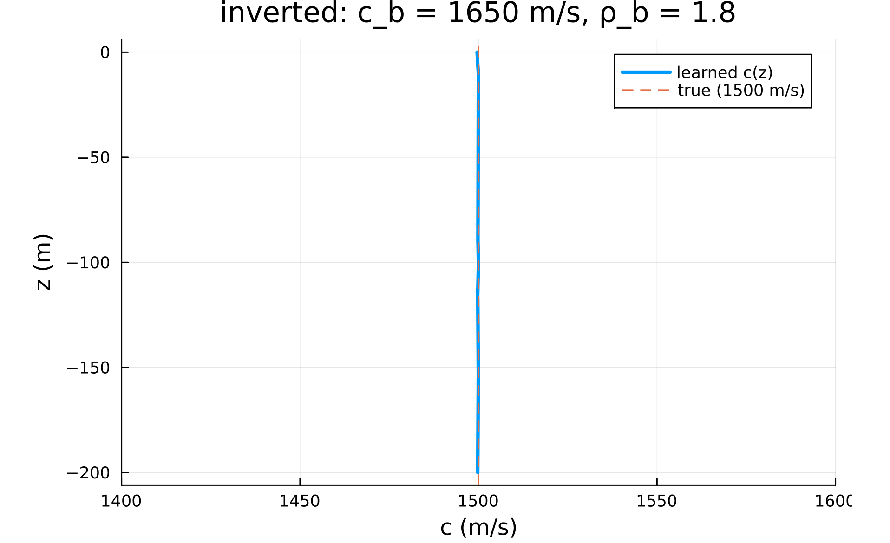
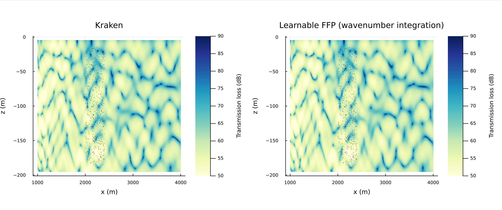
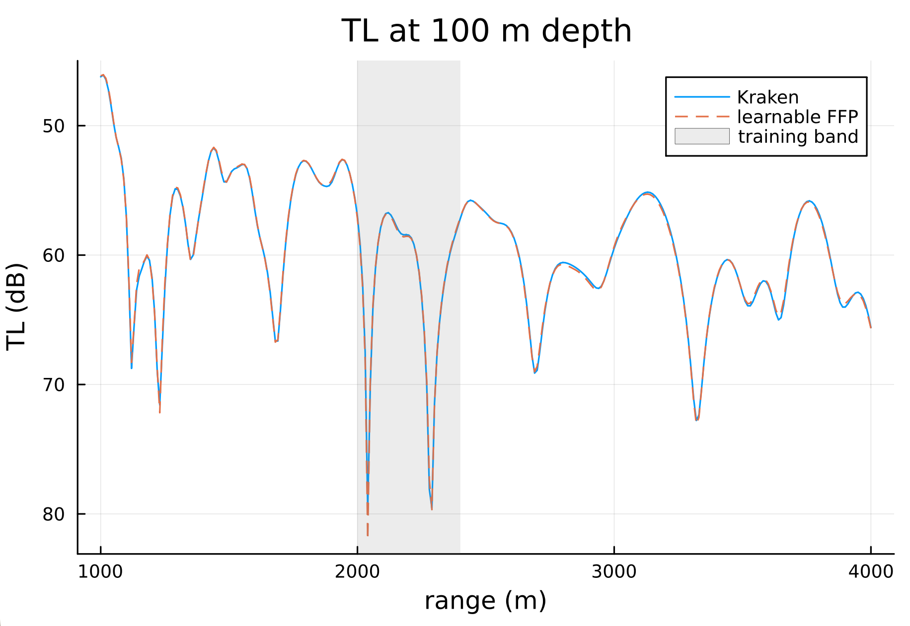
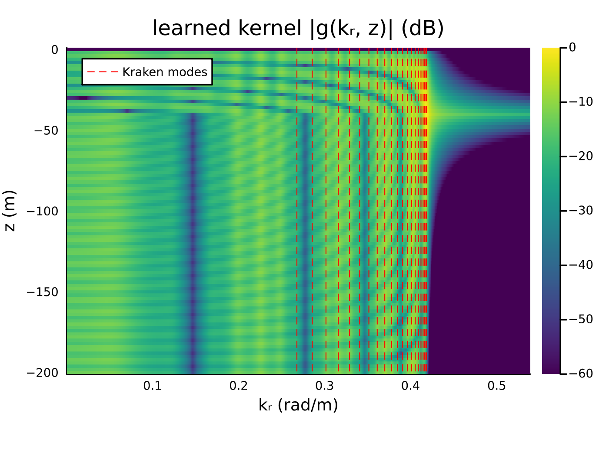

# Full-wave field prediction and geoacoustic inversion

This example trains `WavenumberIntegrationNN_2D`, a learnable fast-field
program, on sparse complex-field measurements from a shallow waveguide, and
uses it both to predict the field far outside the measurement region and to
invert for the environment. Paste each block into the Julia REPL in order.

What is learned is the environment: the water sound speed c(z), the seabed
sound speed, density ratio and attenuation, plus a complex source factor s.
Because the kernel is a full Green's function, it contains the trapped modes,
the leaky modes and the near-field continuum alike.

The setup is a 200 m deep waveguide at 100 Hz over a fluid seabed (sound
speed 1650 m/s, density ratio 1.8), with a source at 40 m. Kraken generates 400
complex-field measurements at random positions in a narrow 2.0–2.4 km range
band, and the model is evaluated against Kraken over 1–4 km. The model only
ever sees the narrow band.

> [!NOTE]
> The kernel is evaluated independently at several hundred wavenumbers, and
> this is threaded. Start Julia with threads enabled, otherwise training runs
> on a single core:
> ```
> julia --project=. -t auto
> ```

## 1. Load packages

`AcousticsToolbox` provides Kraken for the ground truth:

```julia
using UnderwaterAcoustics
using DataDrivenAcoustics
using AcousticsToolbox
using StableRNGs
using Statistics
using Plots
```

## 2. Settings

The true seabed values are only used to generate the ground truth and to
report the inversion error; the model is never given them:

```julia
const D = 200.0;          const FREQ = 100.0;       const SOURCE_Z = -40.0
const C_WATER = 1500.0
const SEABED_C = 1650.0;  const SEABED_RHO = 1.8    # ground truth only
const BAND = (2000.0, 2400.0)                        # measurement ranges (m)
const DEPTHS = (15.0, 185.0)                         # measurement depths (m)
const AOI_X = 1000.0:10.0:4000.0;  const AOI_Z = -195.0:1.0:-5.0
const CB_SCAN = 1525.0:50.0:2475.0                   # seabed sound speeds tried before training
const ITERATIONS = 50
```

## 3. Generate the ground truth

One Kraken run gives the 400 complex-field measurements in the band. Kraken's
mode wavenumbers are also kept, only to overlay on the learned kernel later:

```julia
env = UnderwaterEnvironment(bathymetry=D, soundspeed=C_WATER,
                            seabed=FluidBoundary(SEABED_RHO * 1000.0, SEABED_C))
kraken = Kraken(env)
tx = AcousticSource(0.0, SOURCE_Z, FREQ)

rxpos = rand(StableRNG(1224), 2, 400) .*
        [BAND[2] - BAND[1], DEPTHS[2] - DEPTHS[1]] .+ [BAND[1], -DEPTHS[2]]
rxs = [AcousticReceiver(rxpos[1, i], rxpos[2, i]) for i ∈ 1:size(rxpos, 2)]
xfield = ComplexF64.(acoustic_field(kraken, tx, rxs))

kr_true = sort([real(a.kᵣ) for a ∈ arrivals(kraken, tx, rxs[1])])
```

## 4. Build the model and the loss

The model takes the water depth, frequency and source depth; the source depth
is assumed known. `rmax` sets the integration grid, and covers the furthest
range we will predict at, not just the measurement band:

```julia
model = WavenumberIntegrationNN_2D(D, FREQ, SOURCE_Z; rmax=maximum(AOI_X))
pm = DataDrivenPropagationModel(model; rng=StableRNG(42))
```

The loss is a relative complex-field misfit. The overall source level and
phase are a single complex number that enters the field linearly, so rather
than training it, it is solved exactly by least squares on every evaluation;
this keeps the optimizer focused on the environment:

```julia
best_source_factor(p, y) = sum(conj.(p) .* y) / sum(abs2, p)

relative_misfit(pm, y) = (ps, _) -> begin
  p = acoustic_field(pm(ps), tx, rxs)
  sum(abs2, best_source_factor(p, y) .* p .- y) / sum(abs2, y)
end
```

The model assumes e^{-iωt} time dependence, for which H₀⁽¹⁾ is the outgoing
wave. If the data were generated with the opposite convention, the field is
the complex conjugate, and the conjugated data will fit much better:

```julia
flip = relative_misfit(pm, conj.(xfield))(pm.params, nothing) <
       relative_misfit(pm, xfield)(pm.params, nothing)
y = flip ? conj.(xfield) : xfield
loss = relative_misfit(pm, y)
println("time convention: ", flip ? "conjugated" : "as is")
```

## 5. Warm-start the seabed

The misfit has local minima in the seabed sound speed, which moves the
critical angle and with it which modes are trapped. A coarse scan, keeping all
other parameters at their initial values, picks the starting basin:

```julia
seabed_logit(cb) = log((cb - model.cb_lo) / (model.cb_hi - cb))
scan = map(CB_SCAN) do cb
  pm.params.seabed.qc = seabed_logit(cb)
  loss(pm.params, nothing)
end
pm.params.seabed.qc = seabed_logit(CB_SCAN[argmin(scan)])
println("seabed c scan picked ", CB_SCAN[argmin(scan)], " m/s")
```

## 6. Train

`fit!` trains this model with forward-mode AD. The first iteration includes
compilation, so expect a pause before the progress starts:

```julia
DataDrivenAcoustics.fit!(pm, loss; optimizer=BFGS(), maxiters=ITERATIONS, show_progress=5)
println("final relative misfit: ", round(loss(pm.params, nothing); sigdigits=3))
```

The least-squares source factor is then folded into the model's own `s`, so
the trained model can be called directly without the loss:

```julia
s = best_source_factor(acoustic_field(pm, tx, rxs), y) * complex(pm.params.s_re, pm.params.s_im)
pm.params.s_re, pm.params.s_im = real(s), imag(s)
```

## 7. Inspect the inverted environment

The seabed and the water sound speed, against the values the model was never
given:

```julia
sb = seabed_parameters(model, pm.params)
println("seabed c = ", round(sb.c; digits=1), " m/s (true ", SEABED_C, ")")
println("seabed ρ = ", round(sb.ρ; digits=2), " (true ", SEABED_RHO, ")")
println("seabed α = ", round(sb.α; digits=3), " dB/λ (true 0)")

c_pred = sound_speed_grid(model, pm.params).(.-model.zgrid)
println("water c RMSE = ", round(sqrt(mean(abs2, c_pred .- C_WATER)); digits=2), " m/s")

plot(c_pred, -model.zgrid; lw=2.5, label="learned c(z)", xlabel="c (m/s)",
     ylabel="z (m)", xlims=(model.cmin, model.cmax),
     title="inverted: c_b = $(round(Int, sb.c)) m/s, ρ_b = $(round(sb.ρ; digits=2))")
vline!([C_WATER]; ls=:dash, label="true ($(Int(C_WATER)) m/s)")
```



## 8. Evaluate the field over the area of interest

Predict over the full 1–4 km grid and compare against Kraken; the measurement
positions are marked in black:

```julia
rx = AcousticReceiverGrid2D(AOI_X, AOI_Z)
tl_true = transmission_loss(kraken, tx, rx)
tl_pred = transmission_loss(pm, tx, rx)

outside = [x < BAND[1] || x > BAND[2] for x ∈ AOI_X, z ∈ AOI_Z]
println("TL RMSE outside the training band = ",
        round(sqrt(mean(abs2, (tl_pred .- tl_true)[outside])); digits=2), " dB")

p1 = plot(rx, tl_true; clim=(50, 90), title="Kraken")
scatter!(p1, rxpos[1, :], rxpos[2, :]; markersize=0.5, color=:black, label="")
p2 = plot(rx, tl_pred; clim=(50, 90), title="Learnable FFP (wavenumber integration)")
scatter!(p2, rxpos[1, :], rxpos[2, :]; markersize=0.5, color=:black, label="")
plot(p1, p2; layout=(1, 2), size=(1300, 450), margin=5Plots.mm)
```



A single depth shows the detail more clearly. The prediction follows Kraken
from 1 km to 4 km, far outside the shaded training band:

```julia
iz = findfirst(==(-100.0), AOI_Z)
plot(AOI_X, tl_true[:, iz]; label="Kraken", xlabel="range (m)", ylabel="TL (dB)",
     title="TL at 100 m depth", yflip=true)
plot!(AOI_X, tl_pred[:, iz]; label="learnable FFP", ls=:dash)
vspan!(collect(BAND); alpha=0.15, color=:gray, label="training band")
```



## 9. Plot the learned kernel

The kernel |g(kᵣ, z)| for the inverted environment, with Kraken's mode
wavenumbers overlaid. The sharp ridges are the trapped and leaky modes; the
smooth band at lower kᵣ is the continuum, and the bright region above
k ≈ ω/c near the source depth is the evanescent near field. A modal model
represents only the ridges:

```julia
G = wavenumber_kernel(model, pm.params)
gdb = 20 .* log10.(abs.(G) ./ maximum(abs, G) .+ 1e-12)
heatmap(model.kr, reverse(-model.zgrid), reverse(gdb; dims=1); clims=(-60, 0),
        xlabel="kᵣ (rad/m)", ylabel="z (m)", c=:viridis,
        title="learned kernel |g(kᵣ, z)| (dB)")
vline!(kr_true; color=:red, ls=:dash, lw=0.6, label="Kraken modes")
```



## Notes on the integration

Two numerical details matter for accuracy at long range, and both are handled
inside the layer:

- **Contour offset.** The integral is evaluated along kᵣ − iε, slightly below
  the real axis, so the mode poles never lie on the integration path. Every
  term of the sum then carries a factor e^{εr}, which reaches about 1000 at
  4 km and cancels only in the full integral.
- **Tapered ends.** Because of that factor, any sharp edge in the integrand
  leaves an error growing as e^{εr}, which appears as fine ripple at long range.
  The grid is therefore Hann-tapered at both ends: from ω/c_min to the top of
  the grid, where every kᵣ is evanescent, and from 0 to 0.02 rad/m, where the
  near-vertical energy carries nothing to these ranges. Against a reference
  with a 4× smaller ε and a 16× finer grid, the tapered sum agrees to about
  0.01 dB from 1 to 4 km.

## Publications

- F. B. Jensen, W. A. Kuperman, M. B. Porter, and H. Schmidt, *Computational
  Ocean Acoustics*, 2nd ed. New York: Springer, 2011. (Chapter 4: wavenumber
  integration and the fast-field program.)
- K. Li and M. Chitre, "Physics-aided data-driven modal ocean acoustic
  propagation modeling," in International Congress of Acoustics, 2022.
  [(online)](https://arl.nus.edu.sg/wp-content/uploads/2022/09/Kexin_Physics-aided_ICAKorea2022.pdf)
