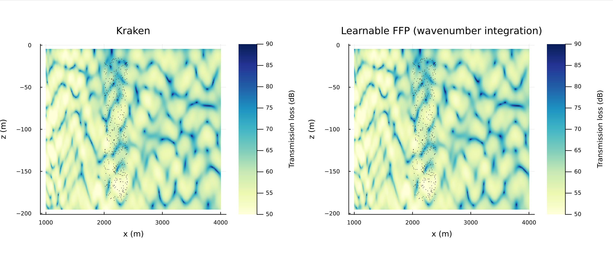
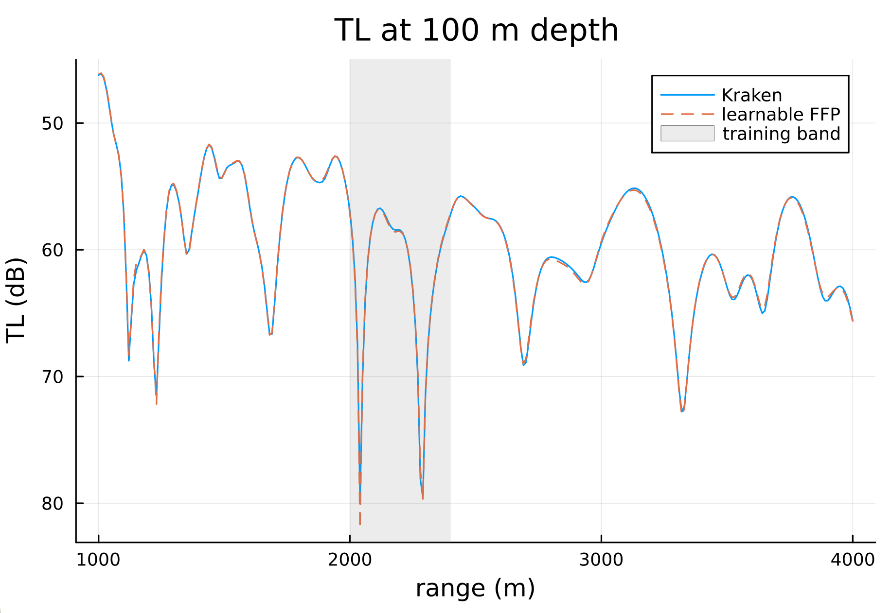
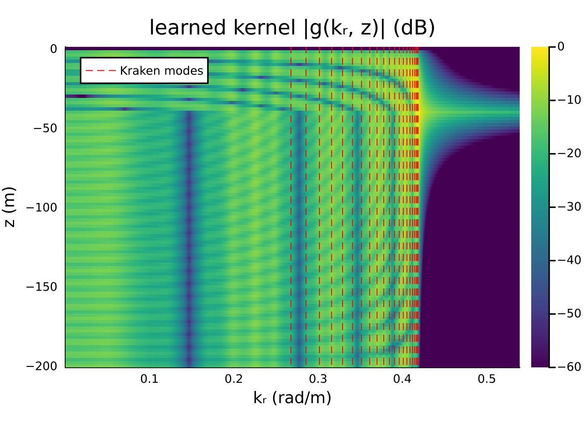
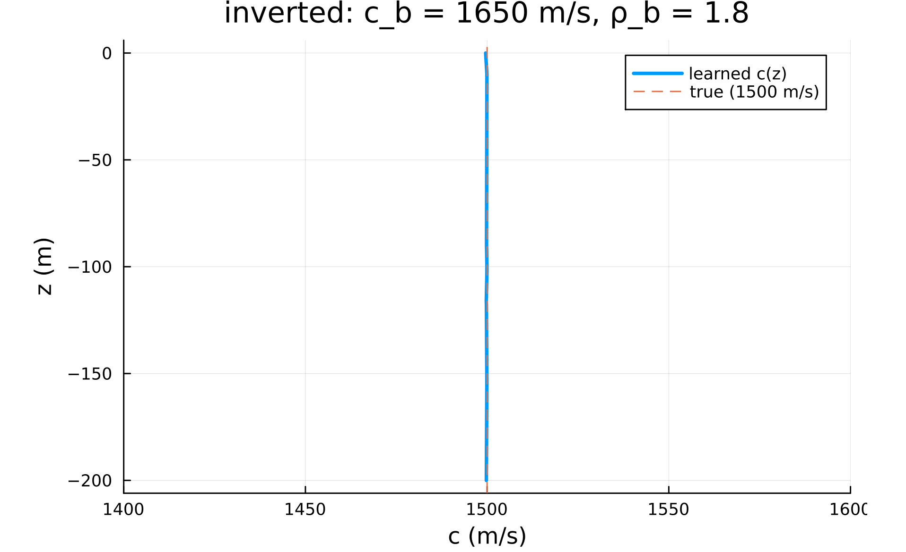

# Sample Implementation

This walks through the entire example chunk by chunk. Paste each block into
the Julia REPL **in order** and it produces a comparison against ground truth
generated by Kraken.

# Full-wave field prediction and geoacoustic inversion

This example trains `WavenumberIntegrationNN_2D`, a learnable fast-field
program, on sparse complex-field measurements from a shallow waveguide, and
uses it both to predict the field far outside the measurement region and to
invert for the environment.

What is learned is the environment: the water sound speed c(z), the seabed
sound speed, density ratio and attenuation, plus a complex source factor s.
Because the kernel is a full Green's function, it contains the trapped modes,
the leaky modes and the near-field continuum alike.

The setup is a 200 m deep waveguide at 100 Hz over a fluid seabed (sound
speed 1650 m/s, density ratio 1.8), with a source at 40 m. Kraken generates 400
complex-field measurements at random positions in a narrow 2.0–2.4 km range
band, plus a dense evaluation grid covering 1–4 km. The model only ever sees
the narrow band.

Training uses L-BFGS with forward-mode gradients, after a coarse scan over the
seabed sound speed to start in the right basin. The result is evaluated by
comparing the predicted field against Kraken over the full 1–4 km area, and
the inverted environment against the true one it was never given.


> [!NOTE]
> The kernel is evaluated independently at several hundred wavenumbers, and
> this is threaded. Start Julia with threads enabled, otherwise training runs
> on a single core:
> ```
> julia --project=. -t auto
> ```

## 1. Load packages

`WavenumberIntegrationNN_2D`, `wavenumber_kernel`, `seabed_parameters` and
`sound_speed_grid` come in with `DataDrivenAcoustics`. `AcousticsToolbox`
provides Kraken for the ground truth. The depth solver inside the kernel
updates arrays in place, which reverse-mode AD (Zygote) cannot differentiate,
so gradients come from `ForwardDiff`; with only about 30 trainable parameters,
forward mode is also the cheaper choice. `Optim` provides L-BFGS:

```julia
using UnderwaterAcoustics
using DataDrivenAcoustics
using AcousticsToolbox
using StableRNGs
using Plots

using LinearAlgebra, Statistics
using Lux, ComponentArrays, ForwardDiff, Optim

gr() #plots backend
```

## 2. Settings

Environment, measurement layout, model bounds and training budget. The true
seabed values are only used to generate the ground truth and to report the
inversion error; the model is never given them:

```julia
const D = 200.0;        const FREQ = 100.0;     const SOURCE_Z = -40.0
const C_WATER = 1500.0
const SEABED_C = 1650.0; const SEABED_RHO = 1.8   #ground truth only
const NPOINTS = 400
const BAND = (2000.0, 2400.0)                     #measurement ranges (m)
const DEPTHS = (15.0, 185.0)                      #measurement depths (m)
const AOI_X = 1000.0:10.0:4000.0;  const AOI_Z = -195.0:1.0:-5.0

#water sound speed bounds plus the initial guess
const CMIN = 1400.0;  const CMAX = 1600.0;  const CINIT = 1500.0
#seabed sound speeds tried before training to pick a starting basin
const CB_SCAN = 1525.0:50.0:2475.0
const ITERATIONS = 50

#plots
const FIELD_PLOT_FILE  = "wift_field.png"
const TL_PLOT_FILE     = "wift_tl_100m.png"
const KERNEL_PLOT_FILE = "wift_kernel.png"
const SSP_PLOT_FILE    = "wift_ssp.png"

save_plot(plt, f) = (display(plt); savefig(plt, joinpath(@__DIR__, f)); println("Saved: ", joinpath(@__DIR__, f)))
```

## 3. Generate the ground truth

One Kraken run gives the 400 complex-field measurements in the band. Kraken's
mode wavenumbers are also kept, only to overlay on the learned kernel later:

```julia
env = UnderwaterEnvironment(bathymetry = D, soundspeed = C_WATER,
                            seabed = FluidBoundary(SEABED_RHO * 1000.0, SEABED_C))
pm = Kraken(env)
tx = AcousticSource(0.0, SOURCE_Z, FREQ)

rxpos = rand(StableRNG(1224), 2, NPOINTS) .*
        [BAND[2] - BAND[1], DEPTHS[2] - DEPTHS[1]] .+ [BAND[1], -DEPTHS[2]]
rxs = [AcousticReceiver(rxpos[1, i], rxpos[2, i]) for i ∈ 1:NPOINTS]
xfield = ComplexF64.(acoustic_field(pm, tx, rxs))

kr_true = try
    sort([real(a.kᵣ) for a ∈ arrivals(pm, tx, rxs[1])])
catch err
    @info "could not read Kraken mode wavenumbers" err
    Float64[]
end
```

## 4. Build the model and the training inputs

The model takes the water depth, frequency and source depth; the source depth
is assumed known. `rmax` sets the integration grid, and should cover the
furthest range you intend to predict at, not just the measurement band.
Targets are normalised by their largest magnitude so the loss is O(1):

```julia
model = WavenumberIntegrationNN_2D(D, FREQ, SOURCE_Z; cmin = CMIN, cmax = CMAX,
                                   cinit = CINIT, rmax = maximum(AOI_X))
println("integration points: ", length(model.kr), ", threads: ", Threads.nthreads())

make_input(r, z) = vcat(r', z', fill(2π * FREQ / soundspeed(), 1, length(r)))
X_train = make_input(rxpos[1, :], rxpos[2, :])

scalefac = maximum(abs, xfield)
yv = xfield ./ scalefac

ps0, st = Lux.setup(StableRNG(42), model)
ps0 = ComponentArray(ps0)
```

## 5. Define the loss

Relative complex-field misfit. The overall source level and phase are a single
complex number that enters the field linearly, so rather than training it, it
is solved exactly by least squares on every evaluation; this keeps the
optimiser focused on the environment:

```julia
function misfit(θ, y)
    out, _ = model(X_train, θ, st)
    p = complex.(out[1, :], out[2, :])
    α = dot(p, y) / dot(p, p)          #best complex source factor
    sum(abs2, α .* p .- y) / sum(abs2, y)
end
```

The model assumes e^{-iωt} time dependence, for which H₀⁽¹⁾ is the outgoing
wave. If the data were generated with the opposite convention, the field is
the complex conjugate, and the conjugated data will fit much better:

```julia
flip = misfit(ps0, conj.(yv)) < misfit(ps0, yv)
y_train = flip ? conj.(yv) : yv
println("time convention: ", flip ? "conjugated" : "as is")
```

## 6. Warm-start the seabed

The misfit has local minima in the seabed sound speed, which moves the
critical angle and with it which modes are trapped. A coarse scan, keeping all
other parameters at their initial values, picks the starting basin:

```julia
seabed_logit(cb) = log((cb - model.cb_lo) / (model.cb_hi - cb))
function with_seabed_c(θ, cb)
    θ2 = copy(θ)
    θ2.seabed.qc = seabed_logit(cb)
    θ2
end

scan = [misfit(with_seabed_c(ps0, cb), y_train) for cb ∈ CB_SCAN]
θ0 = with_seabed_c(ps0, CB_SCAN[argmin(scan)])
println("seabed c scan picked ", CB_SCAN[argmin(scan)], " m/s, misfit ",
        round(minimum(scan); sigdigits = 3))
```

## 7. Train

L-BFGS with forward-mode gradients. A single `ForwardDiff` chunk spans every
parameter, so each gradient is one pass through the depth solver, and
backtracking keeps the number of loss evaluations per iteration low. The first
iteration includes compilation, so expect a pause before the trace starts:

```julia
loss(θ) = misfit(θ, y_train)
cfg = ForwardDiff.GradientConfig(loss, θ0, ForwardDiff.Chunk{length(θ0)}())
grad!(g, θ) = ForwardDiff.gradient!(g, loss, θ, cfg)

result = optimize(loss, grad!, θ0,
                  LBFGS(linesearch = Optim.LineSearches.BackTracking()),
                  Optim.Options(iterations = ITERATIONS, show_trace = true, show_every = 5))
ps = ComponentArray(collect(Optim.minimizer(result)), getaxes(θ0))
println("final relative misfit: ", round(loss(ps); sigdigits = 3))
```

The least-squares source factor is then folded into the model's own `s`, so
the trained model can be called directly without the loss:

```julia
out, _ = model(X_train, ps, st)
p = complex.(out[1, :], out[2, :])
s = (dot(p, y_train) / dot(p, p)) * complex(ps.s_re, ps.s_im)
ps.s_re, ps.s_im = real(s), imag(s)
```

## 8. Inspect the inverted environment

The seabed and the water sound speed, against the values the model was never
given:

```julia
sb = seabed_parameters(model, ps)
println("seabed c = ", round(sb.c; digits = 1), " m/s (true ", SEABED_C, ")")
println("seabed ρ = ", round(sb.ρ; digits = 2), " (true ", SEABED_RHO, ")")
println("seabed α = ", round(sb.α; digits = 3), " dB/λ (true 0)")

c_pred = DataDrivenAcoustics._ffp_sound_speed(model, ps)
println("water c RMSE = ", round(sqrt(mean((c_pred .- C_WATER) .^ 2)); digits = 2), " m/s")

p_ssp = plot(c_pred, -model.zgrid; lw = 2.5, label = "learned c(z)",
             xlabel = "c (m/s)", ylabel = "z (m)", xlims = (CMIN, CMAX),
             title = "inverted: c_b = $(round(Int, sb.c)) m/s, ρ_b = $(round(sb.ρ; digits = 2))")
vline!(p_ssp, [C_WATER]; ls = :dash, label = "true ($(Int(C_WATER)) m/s)")
save_plot(p_ssp, SSP_PLOT_FILE)
```

> [!NOTE]
> As with `ModalBasisNN_2D`, `sound_speed_grid(model, ps)` returns a
> `SampledField` wrapper. The internal `_ffp_sound_speed` returns the same
> profile as a plain vector on `model.zgrid`, which is what plotting needs.

## 9. Evaluate the field over the area of interest

Predict over the full 1–4 km grid and compare against Kraken. The kernel is
computed once per call and shared by all receivers, so the whole grid is a
single model call:

```julia
rx = AcousticReceiverGrid2D(AOI_X, AOI_Z)
tl_true = transmission_loss(pm, tx, rx)

R = vec(repeat(collect(AOI_X), 1, length(AOI_Z)))
Z = vec(repeat(collect(AOI_Z)', length(AOI_X), 1))
out, _ = model(make_input(R, Z), ps, st)
pf = scalefac .* complex.(out[1, :], out[2, :])
flip && (pf = conj.(pf))
tl_pred = reshape(-20 .* log10.(abs.(pf) .+ 1e-12), size(tl_true))

outside = reshape((R .< BAND[1]) .| (R .> BAND[2]), size(tl_true))
println("TL RMSE outside the training band = ",
        round(sqrt(mean((tl_pred .- tl_true)[outside] .^ 2)); digits = 2), " dB")

p1 = plot(rx, tl_true; clim = (50, 90), title = "Kraken")
scatter!(p1, rxpos[1, :], rxpos[2, :]; markersize = 0.5, color = :black, label = "")
p2 = plot(rx, tl_pred; clim = (50, 90), title = "Learnable FFP (wavenumber integration)")
scatter!(p2, rxpos[1, :], rxpos[2, :]; markersize = 0.5, color = :black, label = "")
save_plot(plot(p1, p2; layout = (1, 2), size = (1300, 450), margin = 5 * Plots.mm),
          FIELD_PLOT_FILE)
```

A single depth shows the detail more clearly:

```julia
iz = findfirst(==(-100.0), AOI_Z)
p_tl = plot(AOI_X, tl_true[:, iz]; label = "Kraken", xlabel = "range (m)",
            ylabel = "TL (dB)", title = "TL at 100 m depth", yflip = true)
plot!(p_tl, AOI_X, tl_pred[:, iz]; label = "learnable FFP", ls = :dash)
vspan!(p_tl, collect(BAND); alpha = 0.15, color = :gray, label = "training band")
save_plot(p_tl, TL_PLOT_FILE)
```

## 10. Plot the learned kernel

The kernel |g(kᵣ, z)| for the inverted environment, with Kraken's mode
wavenumbers overlaid. The sharp ridges are the trapped and leaky modes; the
smooth band at lower kᵣ is the continuum, and the bright region above
k ≈ ω/c near the source depth is the evanescent near field. A modal model
represents only the ridges:

```julia
G = wavenumber_kernel(model, ps)
gdb = 20 .* log10.(abs.(G) ./ maximum(abs, G) .+ 1e-12)
p_ker = heatmap(model.kr, reverse(-model.zgrid), reverse(gdb; dims = 1); clims = (-60, 0),
                xlabel = "kᵣ (rad/m)", ylabel = "z (m)", c = :viridis,
                title = "learned kernel |g(kᵣ, z)| (dB)")
isempty(kr_true) || vline!(p_ker, kr_true; color = :red, ls = :dash, lw = 0.6,
                           label = "Kraken modes")
save_plot(p_ker, KERNEL_PLOT_FILE)
```

## Final Plots

After the programme is run, it displays four figures. The first compares
Kraken ground truth with the learnable FFP over the full area of interest; the
measurement positions are marked in black:



The second compares transmission loss at 100 m depth, with the training band
shaded. The prediction follows Kraken from 1 km to 4 km, far outside the band
the model was trained on:



The third shows the learned kernel, with sharp ridges on Kraken's mode
wavenumbers, the continuum below them, and the evanescent near field above:



The fourth shows the inverted water sound speed against the true profile, with
the recovered seabed sound speed and density ratio in the title:



## Notes on the integration

Two numerical details matter for accuracy at long range, and both are handled
inside the layer:

- **Contour offset.** The integral is evaluated along kᵣ − iε, slightly below
  the real axis, so the mode poles never lie on the integration path. Every
  term of the sum then carries a factor e^{εr}, which reaches about 1000 at
  4 km and cancels only in the full integral.
- **Tapered ends.** Because of that factor, any sharp edge in the integrand
  leaves an error growing as e^{εr}, which appears as fine ripple at long range.
  The grid is therefore Hann-tapered at both ends: from ω/c_min to the top of
  the grid, where every kᵣ is evanescent, and from 0 to 0.02 rad/m, where the
  near-vertical energy carries nothing to these ranges. Against a reference
  with a 4× smaller ε and a 16× finer grid, the tapered sum agrees to about
  0.01 dB from 1 to 4 km.

## Publications

- F. B. Jensen, W. A. Kuperman, M. B. Porter, and H. Schmidt, *Computational
  Ocean Acoustics*, 2nd ed. New York: Springer, 2011. (Chapter 4: wavenumber
  integration and the fast-field program.)
- K. Li and M. Chitre, "Physics-aided data-driven modal ocean acoustic
  propagation modeling," in International Congress of Acoustics, 2022.
  [(online)](https://arl.nus.edu.sg/wp-content/uploads/2022/09/Kexin_Physics-aided_ICAKorea2022.pdf)
